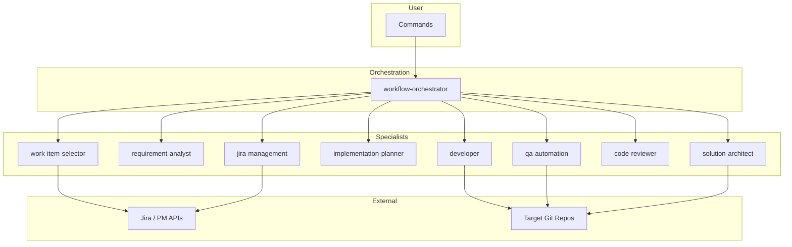

# DevFlow AI Architecture

## Overview

DevFlow AI is a **Cursor Plugin** (`.cursor-plugin/plugin.json`) that packages agents, commands, skills, rules, hooks, and optional MCP servers into a distributable SDLC workflow.

## Boundaries

| Layer | Responsibility |
|-------|----------------|
| Commands | User entry points; map to agents/skills |
| Agents | Role prompts and delegation contracts |
| Skills | Reusable procedures (Jira approval, test structure) |
| Rules | Always-on engineering standards |
| Hooks | Git/MCP safety guards |
| Variables | Jira connection metadata (secrets in dashboard) |

## Approval gates (Release 1)

1. Issue selection (user choice)
2. Assignment (`APPROVED: issue=… assignee=…`)
3. Implementation (explicit plan approval)
4. Jira writes (per-field)

## Multi-repo

Plugin content is repo-agnostic. Target repository context comes from **project-discovery** at runtime in the user's workspace—not from plugin source.